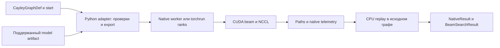

# CayleyPy и интеграция нашего beam search

Дата исследования: **31 августа 2026**. Это обзор проверенного кода, upstream и границ интеграции; адаптер пока не реализован. Производственные CUDA-файлы и существующие worktree не изменялись.

## 1. Основной вывод

**Уточнение постановки от пользователя, 31 августа:** цель — удобно запускать наш native beam search из API CayleyPy для исследования представимых этим движком графов библиотеки. Не требуется воспроизвести beam upstream или немедленно поддержать произвольную задачу/модель. Сохраняется собственный более производительный поисковый pipeline; согласуются входной граф, вызов поиска и возвращаемый результат. Поддержка меньшего state уже реализована и должна использоваться автоматически.

**CayleyPy подходит как библиотечный интерфейс для нашего поискового движка. Начинать следует с дополнительного backend, исполняющего весь native search, и строгого преобразования графа/модели/результата.** Подключение только нашего inference через `Predictor` не переносит в библиотеку преимущества глобального beam, компактных кандидатов, GPU dedup, BFS-touch и NCCL.

У upstream уже появился полезный контракт `Predictor.score_children(states) -> [N, G]`. Различия в выборе дубликатов, квантовании score, effective beam и истории описаны ниже для документирования собственного native алгоритма. Они **не являются препятствием интеграции и не создают требования повторить frontier/траекторию upstream**. Обязательны правильное действие генераторов, привязка оценок и валидность возвращаемого пути.

Две задачи нужно разделить:

1. **Запуск нашего solver для графа CayleyPy.** Преобразование `CayleyGraphDef`, выбор поддержанного native model artifact, выполнение и возврат replay-valid пути. Уже есть значительная часть Python-обвязки в нашем worktree.
2. **Запуск произвольной upstream-модели внутри нашего solver.** Отдельная работа по model ABI/export и численной совместимости. Совпадение названия `ResMLP` не означает совместимости архитектур.

Весь материал исследования:

| Материал | Содержание |
|---|---|
| [Upstream code audit](D:/100XH100/test_results/cayleypy_research_2026-08-31/upstream_code_audit.md) | Подробные таблицы API, алгоритмы, layout, hash/BFS/history, Predictor, модели; ссылки на строки |
| [Native contract audit](D:/100XH100/test_results/cayleypy_research_2026-08-31/native_contract_audit.md) | Наши executable/model/state/multi-GPU контракты, разные worktree, пригодные части адаптера |
| [Экосистема и upstream](D:/100XH100/test_results/cayleypy_research_2026-08-31/upstream_ecosystem.md) | Release, docs, CI, открытые PR и их зависимости, papers, related repos |
| [Результаты тестов](D:/100XH100/test_results/cayleypy_research_2026-08-31/runtime_checks.json) | 133 пройденных теста upstream на CPU, команды, runtime |
| [Проверки контрактов](D:/100XH100/test_results/cayleypy_research_2026-08-31/contract_probes.json) | Replay scalar/Q/MITM, формы данных, воспроизведённые ограничения/ошибки |
| [Инвентаризация исходников](D:/100XH100/test_results/cayleypy_research_2026-08-31/source_inventory.json) | Размер кода, список graph factories |

## 2. Что клонировано и какой версии доверять

Полный Git-клон: **`D:\100XH100\CayleyPy`**. Remote: [cayleypy/cayleypy](https://github.com/cayleypy/cayleypy). Ветка `main`, SHA **`28f3841b34009ea8d51bb36eece3dd0be757a145`**, commit от 20 августа 2026. История и remote branches доступны локально, это не ZIP и не shallow clone. Рабочее дерево клона чистое.

Старая копия `_bench_external/cayleypy` оставлена без изменений: её SHA `fbdde24b891d956b9ec905b939f848ecab711978` от 23 мая. В новом main относительно неё — пять first-parent merges #191–195, 16 изменённых файлов, 1898 добавленных/25 удалённых строк. Существующий каталог `cayleypy_public` с output не использовался как clone.

| Параметр | Проверенный снимок |
|---|---|
| PyPI/release | `0.1.0`, опубликован 23 сентября 2025 |
| GitHub main | На 69 commits впереди tag `v0.1.0`, но версия в pyproject тоже `0.1.0` |
| Docs | Sphinx; deployment соответствует точному SHA main |
| Python | >=3.9; main требует `torch>=2.6.0` |
| Зависимости | h5py, kagglehub, numba, numpy, scipy, torch |
| Упаковка | setuptools, обычный Python package; native extension в main нет |
| Лицензия upstream | В репозитории есть MIT LICENSE |
| Объём | 228 tracked files; 69 `.py`, около 10 676 строк Python включая тесты; 27 test files; 92 `.gap` |
| Состояние GitHub | 471 stars, 36 forks, 20 открытых PR, 10 открытых issues на дату снимка |

Источники: [PyPI](https://pypi.org/project/cayleypy/0.1.0/), [release→main](https://github.com/cayleypy/cayleypy/compare/v0.1.0...28f3841b34009ea8d51bb36eece3dd0be757a145), [pyproject](D:/100XH100/CayleyPy/pyproject.toml), [API docs](https://cayleypy.github.io/cayleypy-docs/api.html). Для воспроизводимости нужен SHA, номер `0.1.0` не различает эти API.

Git с Schannel сначала выдал `SEC_E_NO_CREDENTIALS`; клон успешно получен через одноразовый `git -c http.sslBackend=openssl clone ...`. Глобальные настройки Git, proxy и VPN не менялись. Пакет не устанавливался поверх текущего окружения: тесты импортировали именно новый clone.

## 3. Что представляет собой библиотека

Библиотека работает с неявным графом состояний: есть центральное состояние и упорядоченный набор генераторов; сосед вычисляется применением генератора. Поэтому не требуется материализовать весь граф. Основные представления — перестановочные и матричные действия; поддерживаются графы Шрейера с повторяющимися метками состояния.

| Слой | Главные сущности | Зачем нам |
|---|---|---|
| Математическое описание | `CayleyGraphDef`, `MatrixGenerator` | Источник generators, center, move order, inverse mapping |
| Runtime | `CayleyGraph`, `DeviceConfig`, `StringEncoder`, `StateHasher` | CPU/CUDA tensors, упаковка, применение ходов, unique |
| Графы | `PermutationGroups`, `MatrixGroups`, `Puzzles`, `GapPuzzles`, `create_graph`, `prepare_graph` | Библиотечный вход для разных задач |
| Поиск | `BeamSearchAlgorithm`, `BfsAlgorithm`, `BfsDistributed`, `MeetInTheMiddle`, `find_path` | Python baseline и существующий интерфейс поиска |
| Эвристика | `Predictor`, `ModelConfig`, MLP, ResMLP | Scalar/Q контракт и загрузка моделей |
| Токенизация/обучение | `GroupTokenizer`, MSE/Pinball, `RandomWalksGenerator` | Описание pieces, данные и losses; полного trainer в main ещё нет |
| Результаты | `BeamSearchResult`, `BfsResult`, `CayleyPath`, datasets | Paths, сохранение BFS, conversion в NetworkX/матрицы для малых графов |

В текущем коде 36 публичных factories в `PermutationGroups`, 3 в `MatrixGroups`, 9 в `Puzzles`, плюс GAP-файлы. Семейства включают LRX/LX, TopSpin, transpositions/transposons, Coxeter A/B/D, pancake/burnt pancake, reversals, cycles, stars, Rapaport, Heisenberg, special linear groups. Головоломки: кубы с разными метриками, globe, Hungarian rings, Pyraminx/Pyramorphix, picture cube, Starminx и Megaminx.

GAP-файлы разбираются ограниченным parser, GAP как внешняя система не запускается. Матричные генераторы — отдельный математический контракт; наличие matrix graph в CayleyPy не делает его допустимым для нашего permutation backend.

README упоминает TPU/JAX в направлениях проекта. В текущем main не обнаружен JAX backend для `CayleyGraph`/beam search. Исторические JAX notebooks и отдельные проекты нужно рассматривать отдельно.

## 4. API поиска: что реально работает

Основной вызов — `graph.beam_search(...)`; он передаёт управление `BeamSearchAlgorithm.search`. `find_path(...)` — дополнительный автоматический выбор pretrained beam или BFS/MITM с собственными ограничениями, поэтому для первой интеграции это менее удобная точка.

| Возможность | `simple`, default | `advanced` |
|---|---|---|
| Эвристический beam | Да, ниже score лучше | Да |
| `return_path=True` | Восстановление пути по сохранённым hash layers | Не передаётся в implementation; нет пути для ненулевого решения |
| `bfs_result_for_mitm` | Используется | Не передаётся, игнорируется |
| `use_child_scores=True` | Да, через `[N,G]` | Явный `ValueError` |
| `history_depth` | Не передаётся, игнорируется | Ограничивает посещение предыдущих hash-слоёв |
| `destination_state` | Не передаётся, поиск к center | Передаётся; default Hamming всё равно относительно center |
| Несколько GPU | Только первое устройство | Только первое устройство |
| Collect/reflection/restarts | Такого контракта нет | Такого контракта нет |

Defaults: `beam_width=1000`, `max_steps=1000`, `history_depth=0`, `return_path=False`, `use_child_scores=False`, predictor = Hamming. У `CayleyGraph` defaults `batch_size=2**20`, `hash_chunk_size=2**25`, `memory_limit_gb=16`, `device='auto'`, packed encoding `'auto'`.

`BeamSearchResult` содержит всего пять полей: `path_found`, `path_length`, `path`, `debug_scores`, `graph`. `path` — список исходных generator IDs от start к center. `debug_scores` — лучший score только на шагах усечения beam, а не полная телеметрия. В main нет полей для exit reason, OOM, cancellation, effective beam, binary/model hash, результата коллекции. Их следует хранить в отдельном native result с конвертацией в этот простой тип.

### Эффективный порядок simple search

1. Encode start и hash-dedup начального слоя.
2. Материализовать все `B*G` соседей.
3. Stable-sort по int64 hash, оставить первый экземпляр каждого hash.
4. Проверить достижение center/BFS-окрестности **до** усечения по score.
5. При необходимости оценить unique candidates или их родителей через Q-model.
6. `torch.argsort(scores)[:beam_width]`.
7. Сохранить hashes для path restoration, если запрошено.

В Q-режиме dedup сохраняет первого представителя в generator-major порядке. Он **не выбирает минимальный Q-score среди всех parent/move, ведущих к одному состоянию**. У модели Q эти оценки могут различаться. Наш min-score reducer потому не обязан получать тот же frontier даже при одинаковой нейросети.

Источник: [beam_search.py](D:/100XH100/CayleyPy/cayleypy/algo/beam_search.py), подробный разбор — в code audit.

## 5. Представления и стоимость памяти

### Меньший native state уже реализован

В [src/types.hpp](D:/100XH100/src/types.hpp:12) `State128` — alias для `StatePacked`, содержащего `v[STATE_STORAGE_LEN]`. [src/config.hpp](D:/100XH100/src/config.hpp:9) получает logical/storage length и move count из compile definitions. [BeamStateSizing.cmake](D:/100XH100/cmake/BeamStateSizing.cmake:1) определяет размеры из puzzle definition и выравнивает storage с резервом минимум 4 байта для final response. То есть 120/128/24 — один профиль, не неизменный размер движка.

Повторно выполнены существующий `CheckBeamStateSizing.cmake` и [probe фактической sizing function](D:/100XH100/test_results/cayleypy_research_2026-08-31/state_sizing_probe.cmake). При alignment 16: logical 8 → storage 16, 16 → 32, 24 → 32, 32 → 48, 54 → 64, 72 → 80, 96 → 112, 120 → 128. Это проверка build configuration, не новый CUDA solve. Меньший state действительно уменьшает native state storage, но CandidateMeta/Hash128 и прочие независимые buffers не уменьшаются пропорционально.

Есть и сохранённая runtime evidence, перечитанная при уточнении: [IHES 72/80/18](D:/100XH100/test_results/state_specialization_2026-06-12.md:28) — CUDA build и smoke с dummy weights; [Tetraminx state_len=88](D:/100XH100/.worktrees/public-cayleypy-notebook/test_results/cayleypy_public_tetraminx_v2_2026-08-01.md:12) — два T4, replay-valid путь длины 1. Эти старые запуски сейчас не повторялись; они подтверждают, что specialization уже использовалась в реальном runtime, но не доказывают общую solve-quality/performance для всех графов меньшего размера.

Практическая задача адаптера — извлечь `state_size`, `n_generators`, center и ordered moves из `CayleyGraphDef`, затем выбрать/собрать специализацию. Следует кэшировать binary по native revision, state shape/alignment, move count, model backend и GPU/toolchain ABI. Математический граф/генераторы/center и веса получают отдельные fingerprints. **Не нужен hardcoded whitelist имён Megaminx/Cube4/LRX:** допустимость определяется возможностями native representation и scorer.

У существующего CMake inference есть важная деталь: logical length и move count сохраняются в CMakeCache. При повторном использовании build directory с другим puzzle JSON непустые старые значения могут сохраниться. Поэтому adapter должен передавать размеры явно или использовать корректно разделённый build cache; это обычная задача обвязки, не отсутствие native specialization.

### Layout CayleyPy и граница преобразования

Обе реализации применяют permutation как gather: `child[p] = parent[generator[p]]`. Это полезное совпадение, но конкретные move tables/order/names всё равно надо сравнить.

Upstream разделяет decoded int64 state и packed int64 state. Число packed words — `ceil(state_len * bits / 64)`. Упаковка зависит от максимальной метки center, а не только длины состояния.

Проверено на CPU:

| Граф | State entries | Generators | Packed words / bytes | Особенность |
|---|---:|---:|---:|---|
| LRX8 | 8 | 3 | 1 / 8 | Hash равен точному packed state |
| Megaminx | 120 | 24 | 14 / 112 | Identity sticker labels, не 12 цветов |
| Cube4 QTM | 96 | 24 | 5 / 40 | Цветовые метки; иная модель/кодировка, чем identity permutation |
| Heisenberg | 9 = 3×3 | 4 | 9 / 72 | Matrix multiplication, не permutation |

У нашего базового `State128` — 120 логических uint8 и 8 байт padding. Нельзя передавать upstream packed tensor как native state или включать padding в математические координаты. CPU-boundary преобразование допустимо один раз на входе; копирование целого frontier через Python каждый depth лишает смысла native pipeline.

Порядок соседей upstream: `neighbors[g*B + parent]`. Q-output имеет `[parent, g]`; соответствующее flatten требует transpose. Original candidate/source ID необходимо сохранять через compact, sort, dedup и перенос между GPU.

Только массив расширенных состояний Megaminx при `B=2**20`, `G=24` занимает **2.625 GiB** (`B*G*112`). Это расчёт, не измеренный peak. Полная decoded копия тех же кандидатов заняла бы **22.5 GiB** (`B*G*120*8`), если бы все кандидаты были уникальны; фактически размер зависит от dedup. Ещё нужны hashes, sort indices, unique copies, scores и path history.

`batch_size` ограничивает модельный batch, но scalar path сначала декодирует весь unique frontier. `memory_limit_gb` не ограничивает live allocations beam; это не защита от OOM. Наше преимущество потенциально заключается прежде всего в отсутствии полного expanded state tensor, фиксированной временной памяти, позднем materialization и распределении глобального beam. Численного ускорения этот обзор не измерял.

## 6. Модели, checkpoint и tokenizer

`Predictor` принимает Hamming/zero, PyTorch module, callable или объект с `predict`. Scalar contract: decoded states → `[N]`. Q contract: `score_children(decoded_states)` → `[N,G]`; модель должна объявить `n_outputs=G`, чтобы Predictor использовал fast path одного forward на parent. Inference выполняется под `torch.no_grad`, module переводится в eval/device, результаты batch объединяются по dimension 0.

В `main`:

- **MLP:** one-hot по position/class → Linear+LayerNorm+ReLU на каждом hidden → head.
- **ResMLP:** подобные блоки; skip только когда размеры входа и выхода блока совпадают.
- Оба имеют scalar или G outputs. Это ещё не upstream Q-transformer.
- В registry pretrained сейчас только LRX16 и LRX32, веса загружаются с Kaggle. Megaminx/Cube4 в registry не зарегистрированы.
- `Puzzles.megaminx()` и `Puzzles.rubik_cube(4,'QTM')` в runtime inventory имеют пустое `name`; для registry нужно стабильное имя. Native compatibility лучше проверять graph fingerprint, а не name.

`ModelConfig` содержит архитектуру, размеры, `n_outputs`, `tokenizer_groups`, `graph_hash`, paths/идентификаторы весов. Self-describing checkpoint format v1 хранит config+state_dict; загрузка использует `weights_only=True`. SHA256 `graph_hash` учитывает упорядоченные генераторы, их тип/modulo и center; имена не учитывает. Это fingerprint определения графа, **не runtime hash состояния**.

`GroupTokenizer([[3,20],[2,30]])` для Megaminx даёт 50 tokens, vocabulary 60; берётся первая координата каждой группы с segment offset. `verify(graph_def)` проверяет целостность pieces и циклический порядок. Само наличие этого поля в ModelConfig не вставляет tokenizer в MLP: текущие MLP работают со своим one-hot input. Совместимость с нашим PieceTransformer требует сравнения layout, embedding, special token, mask, activation, block и head contracts.

**Наш native exporter не поддерживает произвольный `ModelConfig.build_model()`.** В существующей обвязке ожидаются checkpoint signatures BatchNorm-folded ResMLP, embedding/LayerNorm ResMLP или фиксированного PieceTransformer. Upstream `layers.*`/`blocks.*` имеют другую структуру и вычисления. Переименовать ключи недостаточно.

Native также вносит свои score правила: scalar child score получает offset +3; score clamp `[0,300]`, scale 1024 и целочисленное ранжирование. При FP16/BF16/FP8/FP4 нужно проверять не только погрешность forward, но и перестановки ranking, survivors и итоговый solve. Текущий обзор не подтверждает низкую точность или поддержку всех этих форматов выбранным backend.

## 7. Какая часть нашего проекта готова к повторному использованию

Наш root и несколько worktree представляют разные состояния разработки; их возможности не следует складывать в один якобы существующий релиз.

| Каталог | Проверенный HEAD | Роль |
|---|---|---|
| `D:\100XH100` | `b5fcf6b0` | Dirty root; production runner в tracked build MLP-only |
| `.worktrees/public-cayleypy-notebook` | `4f1aa913` | Python contracts/export/run/replay/collect, есть pre-existing dirty files |
| `.worktrees/stream1` | `cf9d0d3b` | Native PieceTransformer и фиксированный LibTorch eager path |
| `.worktrees/megaminx-native-cluster-release` | `2d5f978f` | Чистый при проверке portable Megaminx release, точные SM targets |

Лучший исходный материал для обвязки: [tools/cayleypy_public](D:/100XH100/.worktrees/public-cayleypy-notebook/tools/cayleypy_public/data.py).

| Модуль | Уже решённая часть | Что отделить/обобщить |
|---|---|---|
| `data.py` | Проверка state/generators/class alphabet | Файлы соревнования/ID/sample submission → GraphDef+start |
| `model.py` | Определение supported schema, export, hashes, manifest | Upstream checkpoints и capability negotiation |
| `paths.py` | Replay, реальные inverse permutations, reflection orientation | Имена любых графов и явные ограничения inverse closure |
| `profile.py` | Hardware/memory plan | Конкретные T4-профили → backend/device capabilities |
| `runner.py` | Process/env isolation, логи, history, results | Жёсткие two-T4 assumptions → 1/N ranks |
| `results.py` | Validated results/artifacts | Публикацию и competition policy убрать из обычного поиска |

Наш launcher сейчас вызывает native executable, который читает generator JSON, CSV/overrides, model directory и environment. Прямого публичного Python ABI `search(tensors)` не найдено. Exit code 0 означает завершение процесса, но не обязательно найденное решение. Простого `ctypes` wrapper без выделения lifetime/error/cancellation API недостаточно.

## 8. Матрица совместимости и обязательные ограничения

| Контракт | CayleyPy main | Native: что учесть |
|---|---|---|
| Тип графа | Permutation + matrix | Первый этап permutation-only |
| State size | Runtime shape | Compile-time shape; новый размер может требовать другой binary |
| Alphabet | Decoded int64, ограничения GraphDef | Zobrist alphabet 128; parser принимает до 255, поэтому нужен внешний guard `<128` |
| Move count | От определения | Packed BFS suffix 5 bits → максимум 32 при этих features, несмотря на более широкий byte ID |
| State storage | Packed int64 или decoded | Logical bytes + zero padding; не binary-compatible |
| Hash identity | int64 или точный packed word | Hash128 `{lo,hi}`; upstream BFS hashes напрямую не годятся |
| Модель | Callable/scalar/Q | Поддержанный экспортированный architecture ABI |
| Дубликаты | Первый representative до score | Min-score/candidate rule; эквивалентность надо определить |
| Beam | Запрошенное B | Global B выравнивается; вернуть requested и effective |
| History | Taboo для advanced, hashes для simple path | В основном parent reconstruction; это разные смыслы слова history |
| Цель | Center/simple; custom/advanced | Exact state; не wildcard/predicate |
| Результаты | Один путь либо not-found | First/collect/overflow/depth/reflection имеют разные статусы |
| Multi-GPU | BFS в одном процессе | Native rank per GPU, NCCL, глобальное dedup/selection |
| Rank bound | Внешняя конфигурация устройств | В просмотренном final exchange максимум 128 ranks |
| Платформа | CPU/CUDA Python, CI Linux/Windows/macOS | Native Linux/CUDA/NCCL; Windows-host не означает native Windows поддержку |

BFS cache должен содержать fingerprint: graph/order/center + encoding + state-hasher algorithm/seed + backend format/version. Просто передать `BfsResult` из Python в native нельзя. GPU-resident touch lookup нашего solver надо сохранить; строить/конвертировать cache можно вне горячего цикла.

Глобальный beam и инварианты проекта сохраняются: Stream3 original candidate ID; CandidateMeta 32 bytes/32-byte alignment; Hash128 целиком; Stream4 threshold+compact+CUB/fixed-temp sort/reduce+compact; без shard top-k и semantic shard cap; Stream5 владеет глобальными threshold collectives.

Reflection не является общим свойством любого Schreier graph. Инверсия solution word и перенос результата на original state требуют корректных inverse generators и replay. Для первой API-версии reflection следует оставить отдельным явно поддержанным режимом, по умолчанию off. Collect означает ограниченный набор найденных этим поиском решений, а не доказательство перебора всех решений.

## 9. Upstream уже движется в эту сторону

### Уже merged 19–20 августа

[#191](https://github.com/cayleypy/cayleypy/pull/191) score_children/checkpoints, [#192](https://github.com/cayleypy/cayleypy/pull/192) losses, [#193](https://github.com/cayleypy/cayleypy/pull/193) ResMLP/Q, [#194](https://github.com/cayleypy/cayleypy/pull/194) child-scored beam/provenance, [#195](https://github.com/cayleypy/cayleypy/pull/195) GroupTokenizer. Эти API можно использовать на зафиксированном main.

### Открытые работы, которые пересекаются с интеграцией

| PR | Состояние/важность |
|---|---|
| [#166 Cpp extensions](https://github.com/cayleypy/cayleypy/pull/166) | Optional CPU C++/OpenMP random walks, pybind11/Torch extension, build toggle. Прецедент упаковки, не утверждённый native ABI |
| [#188 torchrun NCCL BFS](https://github.com/cayleypy/cayleypy/pull/188) | Многопроцессный BFS; 28 августа исправляли несогласованные hash seeds между ranks. Не distributed beam |
| [#157 beam unification](https://github.com/cayleypy/cayleypy/pull/157) | Path/MITM для advanced и последующий stacked optimization/iterated beam |
| [#196 trainer](https://github.com/cayleypy/cayleypy/pull/196), [#201 data](https://github.com/cayleypy/cayleypy/pull/201), [#205 Bellman](https://github.com/cayleypy/cayleypy/pull/205) | Обучение/данные — отдельная область. #201 прямо читает wide TSV нашего `TryDotAtwo/cayleypy-beam-results` |
| [#197 ensemble](https://github.com/cayleypy/cayleypy/pull/197), [#198 symmetries](https://github.com/cayleypy/cayleypy/pull/198), [#199 QV](https://github.com/cayleypy/cayleypy/pull/199) | Score может включать ensemble, TTA/transport колонок, consistency; нельзя везде подставить raw model forward |
| [#200 Q-transformer](https://github.com/cayleypy/cayleypy/pull/200) | Пока не main; другое архитектурное описание, не доказанная совместимость с нашим trained model |
| [#202 canonical dedup](https://github.com/cayleypy/cayleypy/pull/202) → [#203 NBT](https://github.com/cayleypy/cayleypy/pull/203) → [#206 pruning](https://github.com/cayleypy/cayleypy/pull/206) | Стек меняет семантику search; не включать автоматически под видом ускорения |

Полный список, bases/draft/status, старый stack #170/#172/#175/#177 и связанные issues — в ecosystem report и CSV. Получены снимки всех 178 PR и 28 issues (открытых и закрытых), доступных через API на дату исследования.

Вывод: большой rewrite upstream `beam_search.py` пересечётся сразу с несколькими ветками. Отдельный backend и небольшой явный dispatch дают более узкую область изменений. Внешних комментариев/PR от нас в этом исследовании не создавалось.

## 10. Что проверено запуском

Окружение: Python 3.11.5, torch 2.8.0+cu128, NumPy 2.2.6, SciPy 1.16.3, Numba 0.61.2, h5py 3.14.0, pytest 8.4.1. PyTorch видит CUDA, но все проверки намеренно выполнялись с `CUDA_VISIBLE_DEVICES=-1`; производительность и native kernels не тестировались.

| Набор | Результат |
|---|---|
| Predictor, MLP/ResMLP, checkpoint, tokenizer, losses | 82 passed |
| Beam API и scalar/Q/provenance parity, bounded cases | 20 passed, 7 deselected |
| Graph definitions/create, StringEncoder, permutation utilities | 31 passed |
| Сумма | **133 passed** |

Семь beam cases исключены из-за pretrained downloads/крупных задач; полный pytest не запускался. Установленный пакет/зависимости не изменялись. Два повторяющихся warning от сторонних asttokens/astroid не связаны с beam correctness.

Дополнительная проверка: LRX8, start `[3,0,2,4,5,6,7,1]`, B=10. Scalar Hamming и эквивалентный Q-model вернули один и тот же путь **`X.L.X.R.R.X`** длины 6. Применение moves приводит точно к center. Beam с depth-3 BFS cache и B=100 также вернул replay-valid путь длины 6. Это маленький функциональный пример, не speed benchmark и не наша native интеграция.

Воспроизведённые границы/дефекты pinned upstream:

| Сценарий | Фактическое наблюдение | Последствие |
|---|---|---|
| `simple` + custom destination | Возврат пустого solved-center path, который не достигает заданного destination | Явно запрещать неподдержанный target режим |
| `advanced` + `return_path=True` | `path_found=True`, length=1, `path=None` | Не считать этот режим готовым path-returning baseline |
| `BfsResult.save/load/get_layer` | `AttributeError: numpy.ndarray ... cpu` | Не строить cache ABI на текущем HDF5 roundtrip без проверки |
| `random_seed=0` | Два разных effective seeds | Хранить действительный seed; 0 сейчас не детерминированный |
| `random_walks(start_state=tensor)` | Ambiguous tensor truth-value RuntimeError | Tensor input требует исправления/обхода |
| NBT default history=0 | Все 10 labels равны 0 при 7 noncentral states | Опасно автоматически использовать как training labels |
| BFS storage limit=0 | Сохраняются 4 слоя/20 states | Ноль сейчас не означает запрет хранения |
| `find_path(..., beam_width=10)` | Duplicate keyword TypeError в pretrained branch | Native лучше начинать с явного поиска, не auto wrapper |
| Matrix + default Hamming scoring | Shape mismatch 9 vs 3 | Matrix tests без scoring не доказывают общий scalar model path |

В probe `find_path` только загрузка pretrained была заменена Hamming через mock, чтобы изолировать передачу kwargs без сети. Остальные ошибки воспроизведены обычными малыми вызовами. Исходники CayleyPy не исправлялись. Это перечень конкретных узких сценариев, не заключение о неработоспособности библиотеки.

Повторить проверки из `D:\100XH100`:

```powershell
python test_results/cayleypy_research_2026-08-31/run_upstream_checks.py
python -B test_results/cayleypy_research_2026-08-31/probe_contracts.py
```

## 11. Предлагаемая форма интеграции

Это дизайн для следующей работы, **не существующий API**.

Желаемый пользовательский интерфейс после подключения dispatch — обычный `graph.beam_search(start_state=..., predictor=..., beam_width=..., backend="native")`. Shape inference, build/cache, native inputs и сбор результата находятся внутри adapter. Параметр `backend` сейчас отсутствует в upstream; `predictor` на первом этапе должен соответствовать поддержанной native модели. Конкретную реализацию вызова (process или binding) можно менять без изменения этого пользовательского сценария.



На первом этапе дополнительный пакет/module условного имени `cayleypy_native`:

```python
# Проект интерфейса, ещё не реализован.
result = native_beam_search(
    graph_definition=graph.definition,
    start_state=start,
    model_artifact=validated_export,
    config=native_config,
)
assert result.replay_valid
path_ids = result.path
```

GraphDef и model artifact экспортируются один раз. Весь expand/score/dedup/selection/history/touch/multi-GPU цикл остаётся в native. Для нового пользователя не требуется ручная подготовка competition CSV; это внутренняя адаптация к текущему executable, пока не выделен чистый request interface.

Из трёх вариантов:

| Вариант | Что даёт | Ограничение |
|---|---|---|
| Native scorer как Predictor | Можно пользоваться upstream loops и расширениями | Не переносит основной поисковый pipeline и масштабирование; model ABI всё равно нужен |
| Дополнительный whole-search backend через process | Использует существующий solver и изоляцию ресурсов | Startup/export/files overhead, отдельная поддержка deployment/cancel |
| In-process C++/pybind search context | Persistent model, прямой tensor interface | Нужно выделить ABI, ownership CUDA streams/allocator/NCCL, lifetime, cleanup, errors |

Рекомендуемая последовательность: второй вариант для функционального контракта, затем третий при измеренной необходимости. Optional native dependency не должна ломать обычный import/install CayleyPy на CPU/macOS/Windows без CUDA. Не делать silent fallback при запросе native: вернуть понятную ошибку unsupported capability.

Native result должен различать `found`, `not_found_within_budget`, `cancelled`, `unsupported`, `capacity_exceeded`, `backend_failed`. Дополнительно: requested/effective global beam, solve/touch/total depths, phase timings, peak memory, graph/model/binary hashes, device/precision/seed, replay outcome, log/artifact paths. Для collect — complete/truncated/reason и набор paths. Вызов библиотеки не публикует результаты в Worker/GitHub и не отправляет jobs на cluster без явного запроса.

## 12. Порядок следующей реализации и критерии готовности

1. **Выбрать immutable native baseline с нужными возможностями.** Зафиксировать worktree/commit и зависимости; использовать существующую specialization по размеру state и числу moves. Область поддержки определяется контрактом representation/scorer, не перечнем конкретных головоломок. Не брать dirty root как сводную последнюю версию.
2. **Описать capabilities.** Linux/CUDA/SM, state length/storage, alphabet, move count, scorer ABI, K1/K2, world size, solve/collect. Проверять до выделения больших GPU buffers.
3. **Выделить adapter без изменения алгоритма.** Переиспользовать data/model/paths/runner; убрать зависимости на Kaggle IDs, two-T4 и publication. Принять GraphDef/start, автоматически подготовить shape-specific build/cache и вернуть generator IDs+telemetry через удобный CayleyPy-facing API.
4. **Установить graph/model parity.** Все generators, inverse IDs, center, class mapping, tokenizer/preprocessing, Q column order, exact export artifact. Никакой неявной сортировки словаря moves.
5. **Подтвердить маленькие случаи и replay.** Depth 0/1, non-self-inverse moves, invalid input, unsupported graphs/models, not-found, K1/K2, bounded collect/overflow. Для известных совпадающих семантик — сравнение с полным BFS oracle.
6. **Проверить native один и два GPU.** Effective global beam, no shard cap, одинаковые hash/graph/model contracts между ranks, output replay, память, cancel/failure cleanup. Проверки на конкретной целевой машине; этот обзор их не заменяет.
7. **Согласовать небольшой upstream dispatch.** Учесть #166, #157/#194/#202 и #188. Исполнитель backend и режим алгоритма — разные параметры. Не включать незавершённые feature branches автоматически.
8. **Упаковка и распространение.** Декларация лицензии native проекта, notices/условия зависимостей и model assets, checksum/capability manifest, install/import без GPU, CI+отдельные GPU smoke.

В root и portable worktree targeted search не нашёл tracked LICENSE нашего native проекта. Это открытый вопрос перед копированием исходников в upstream/распространением binary, а не препятствие текущему локальному исследованию. Правовая совместимость лицензий и третьих компонентов в этом обзоре не устанавливалась.

На момент завершения исследовательской части были готовы исходная кодовая база, карта API/PR, воспроизводимые CPU probes и список несовместимостей. Последующая реализация обвязки описана в разделе 14. Linux native build, CUDA/multi-GPU solve, speed/capacity benchmark и внешняя публикация остаются отдельными проверками; CPU evidence их не заменяет.

## 13. Papers и дальнейшее чтение

1. [A Machine Learning Approach That Beats Large Rubik's Cubes, arXiv:2502.13266](https://arxiv.org/abs/2502.13266): diffusion-distance heuristic и beam search; полезно для понимания целевой задачи и метрики длины решения.
2. [CayleyPy RL: Pathfinding and Reinforcement Learning on Cayley Graphs, arXiv:2502.18663v3](https://arxiv.org/abs/2502.18663v3), revision 15 мая 2026: сочетание diffusion/RL, архитектуры, random walks и search; научная рамка сравнения эвристик.
3. [CayleyPy Growth, arXiv:2509.19162v2](https://arxiv.org/abs/2509.19162v2), revision 1 апреля 2026: growth/diameter computations и математические conjectures. Результаты BFS/growth нельзя выдавать за ускорение нейросетевого beam.

Papers, README, Kaggle notebooks, PyPI release, current main и open PR — разные источники возможностей и результатов. Здесь papers использованы как научный контекст; их численные claims не перепроверены. Полная библиография, NeurIPS proceedings и связанные исторические repos находятся в ecosystem report.

Для первого практического чтения: `cayley_graph_def.py` → `cayley_graph.py` → `predictor.py` → `algo/beam_search.py` → `models/models.py` и `models/checkpoint.py` → наши `tools/cayleypy_public/{data,model,paths,runner}.py`. Именно на этих границах нужно зафиксировать совместимость.

## 14. Реализованная первая обвязка

После подтверждения пользователем направления создан отдельный пакет
[`integrations/cayleypy_native`](D:/100XH100/docs/research/../../integrations/cayleypy_native/README.md).
`enable_native(NativeOptions(...))` включает обратимую маршрутизацию обычного
`graph.beam_search(...)`; отдельно доступны `auto`, `native` и `torch`. Импорт
ничего не патчит и не запускает. Наш алгоритм и upstream source не изменены.

В реализации есть строгий перевод permutation graph/start/center в native
inputs, сохранение порядка moves, проверка графа и model artifacts, экспорт
поддержанных Pilgrim/ResMLPDistance, shape-specific сборка с fingerprint реальных
исходников/CUTLASS/toolchain/SM, изолированный subprocess/torchrun и replay
каждого найденного пути. Наши dedup/global beam/scoring остаются нашими; это не
реализация upstream алгоритма на другом языке. `NativeBeamSearchResult`
совместим с публичным `BeamSearchResult` и добавляет provenance/telemetry.

Fallback разрешён только на этапе проверки возможностей/подготовки. Ошибка
сборки, испорченный явно переданный artifact, авария worker, timeout или неверный
путь не превращаются в новый поиск другим алгоритмом. Для неподдержанного
NativeModel без явно переданного fallback predictor возвращается ошибка.

Первая версия ограничена MLP runtime. Произвольные модели CayleyPy,
PieceTransformer, matrix graphs, custom destination, advanced taboo/history и
внешний BfsResult требуют отдельных адаптеров. Дополнительно подтверждены
ограничения существующего CUDA runtime: BF16 требует SM80+, Q GEMM — количество
outputs кратное 8; scalar path использует другой kernel. Эти условия проверяются
до запуска и не требуют изменения нашего beam search.

CPU/export/subprocess/package проверки и review находятся в
[`test_results/cayleypy_native_adapter_2026-08-31`](D:/100XH100/docs/research/../../test_results/cayleypy_native_adapter_2026-08-31/verification.json).
Проверена совместимость с текущим clone и настоящим PyPI 0.1.0 wheel. Локальный
wheel собран и установлен в изолированную папку для проверки; внешнего release
не было. Последующая проверка на двух T4 описана ниже.

## 15. Сквозная проверка на двух T4

Приватный Kaggle-прогон v4 `trydotatwo/cayleypy-native-adapter-2xt4-validation`
успешно завершён:181 CPU-тест на Linux,12 сравнительных LRX8-сценариев,
два вызова подготовленной модели и10 запусков с настоящим Tetraminx N88/G24.
Шестнадцать поисковых вызовов запускали оба native rank; два дополнительных
native-сценария LRX8 проверяли host-shortcut для цели/нулевого бюджета.
Найденные пути воспроизведены исходными генераторами. Публичные исходники
CayleyPy и native остались чистыми; локальные незакоммиченные native-изменения
не отправлялись в Kaggle.

Подтверждены специализации8→16 и88→96 logical/storage bytes. Обвязка исправляет
служебные требования CLI: приватный `test_results`, разделённые логи rank-ов,
установленную NCCL и microbatch для узких beam. Алгоритм/dedup/shard semantics
не менялись. При запросе beam7 native фактически использует8192; для Tetraminx
запрошенный и фактический beam равны65536.

Добавлен `prepare_native(graph, predictor, native_options=...)`: явный экспорт
модели и подготовка binary один раз, затем обычный `graph.beam_search` с
`prepared.model` и `prepared.options`. Веса закреплены hash и не изменяются
вслед за последующим обучением исходной модели. Новые worker-ы пока создаются
на каждый поиск.

На одноходовой реальной задаче медиана трёх чередующихся warm-вызовов составила
7.14с через API и5.61с для прямого подготовленного native-вызова при одинаковых
весах/графе/параметрах. Worker wall около4.3–4.4с, собственный native search timer
около0.09с. Это проверка служебных расходов, **не измерение превосходства над
Torch или качества на сложной выборке**. Первый вызов со сборкой занял161с.

Полные данные, ошибки промежуточных версий, исходные логи и проверка артефактов:
[`test_results/cayleypy_native_2xt4_2026-08-31`](D:/100XH100/test_results/cayleypy_native_2xt4_2026-08-31/README.md).
